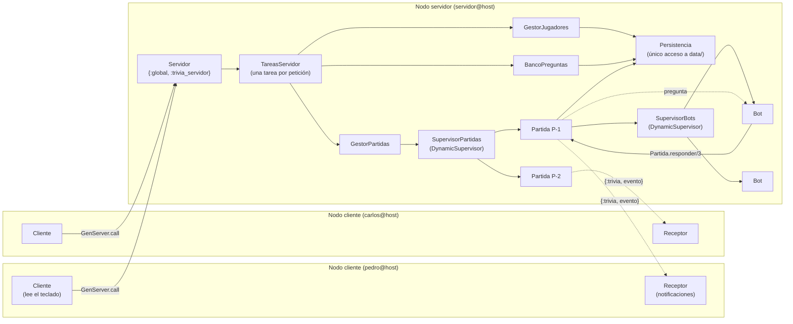
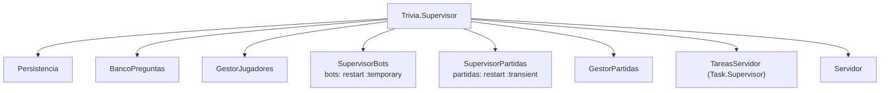
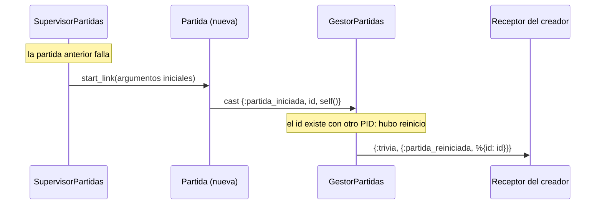

# Trivia Concurrente

Sistema de preguntas y respuestas distribuido, escrito en **Elixir/OTP**. Proyecto final de **Programación III**, Ingeniería de Sistemas y Computación, Universidad del Quindío.

> English version: [README.md](README.md)

## 1. Descripción del proyecto

Trivia Concurrente es un juego de preguntas por consola con arquitectura cliente-servidor. Un **servidor central** (un nodo de Erlang) guarda los usuarios, el banco de preguntas y el historial, y ejecuta las partidas. Cada **cliente** corre en su propia máquina virtual de Erlang, se conecta al servidor por distribución de Erlang y juega contra **bots** que son procesos independientes.

Es un proyecto nuevo que toma como base técnica el proyecto anterior del curso (plataforma de batallas Pokémon distribuida): de él se reutilizaron los patrones de arranque según el rol del nodo, el registro `:global`, un GenServer por sala con notificación a los PID de los clientes y la persistencia en JSON.

Cada partida es un `GenServer` propio supervisado por un `DynamicSupervisor`: las partidas corren en paralelo, ninguna bloquea a otra y, si una falla, se reinicia sola sin afectar al resto.

## 2. Objetivo

Aplicar programación concurrente y distribuida con Elixir/OTP: procesos ligeros, paso de mensajes, `GenServer`, `DynamicSupervisor`, temporizadores no bloqueantes, comunicación entre nodos, persistencia centralizada y pruebas automatizadas.

## 3. Tecnologías utilizadas

| Tecnología | Uso |
|---|---|
| Elixir `~> 1.19` | Lenguaje principal |
| Erlang/OTP 26 o superior | Máquina virtual BEAM, distribución, `:crypto` |
| Mix | Construcción y dependencias |
| GenServer, DynamicSupervisor, Task.Supervisor | Procesos y supervisión |
| `:global` | Registro global del servidor entre nodos |
| Jason `~> 1.4` | Lectura y escritura de JSON (única dependencia) |
| Stream | Recorrido del historial línea a línea |
| ExUnit | Pruebas automatizadas |

## 4. Arquitectura



Árbol de supervisión del servidor (estrategia `:one_for_one`):



En un nodo cliente la aplicación solo levanta `Trivia.SupervisorCliente`, el supervisor del receptor. Un cliente nunca abre los archivos de datos.

## 5. Estructura de directorios

```text
.
├── config/                  # config.exs, dev.exs, test.exs, prod.exs
├── data/
│   ├── questions.json       # Banco de preguntas (versionado)
│   ├── users.json           # Se crea al registrar el primer usuario
│   └── results.log          # Historial; se crea al terminar la primera partida
├── lib/trivia/
│   ├── application.ex       # Arranque según el rol del nodo
│   ├── servidor.ex          # Entrada de peticiones y enrutamiento
│   ├── comandos.ex          # Interpretación del texto de los comandos
│   ├── errores.ex           # Catálogo de errores en español
│   ├── gestor_jugadores.ex  # Registro, sesiones, score y rankings
│   ├── gestor_partidas.ex   # Partidas activas, ubicación y reinicios
│   ├── partida.ex           # GenServer de una partida
│   ├── reglas.ex            # Validaciones centralizadas de la partida
│   ├── supervisor_partidas.ex
│   ├── supervisor_bots.ex
│   ├── bot.ex               # Jugador automático
│   ├── banco_preguntas.ex   # Carga, validación y sorteo de preguntas
│   ├── nivel.ex             # Niveles y distribución de preguntas
│   ├── puntuacion.ex        # Puntos y bonificación por rapidez
│   ├── estadisticas.ex      # Estadísticas desde el historial
│   ├── persistencia.ex      # Único proceso que accede a data/
│   ├── cliente.ex           # Consola del jugador
│   ├── receptor.ex          # Proceso de notificaciones del cliente
│   └── presentacion.ex      # Formato de los textos de la consola
├── test/                    # Pruebas ExUnit y test/support/
└── mix.exs
```

## 6. Responsabilidades de los módulos

| Módulo | Responsabilidad |
|---|---|
| `Trivia.Application` | Decide el rol del nodo (servidor o cliente) y levanta el árbol de supervisión correspondiente. |
| `Trivia.Servidor` | Recibe `{:comando, token, linea, pid_receptor}`, crea una tarea supervisada por petición y enruta el comando a los gestores. Traduce los errores a español. |
| `Trivia.Comandos` | Convierte el texto en un comando estructurado y valida su sintaxis. Lo usa el servidor, no el cliente. |
| `Trivia.Errores` | Catálogo de códigos de error de dominio con sus mensajes. |
| `Trivia.GestorJugadores` | Registro automático, autenticación con contraseña con sal y SHA-256, sesiones con token (una por usuario), monitoreo del cliente, `score` y rankings. |
| `Trivia.GestorPartidas` | Crea partidas con identificador único, garantiza una partida por jugador, ubica el PID de cada partida, detecta reinicios y libera a los jugadores. |
| `Trivia.Partida` | GenServer de una partida: bots, rondas, temporizadores, respuestas, puntuación, finalización e historial. |
| `Trivia.Reglas` | Funciones puras con las reglas de armado y de respuesta. |
| `Trivia.SupervisorPartidas` | `DynamicSupervisor` de las partidas (`restart: :transient`). |
| `Trivia.SupervisorBots` | `DynamicSupervisor` de los bots (`restart: :temporary`). |
| `Trivia.Bot` | Jugador automático: decide su respuesta según la dificultad y responde con `Process.send_after/3`. |
| `Trivia.BancoPreguntas` | Carga y valida `questions.json`, indexa por tema y nivel y sortea sin repetición. |
| `Trivia.Nivel` | Umbrales de nivel y distribución de preguntas con truncamiento. |
| `Trivia.Puntuacion` | Tabla de puntos y bonificación por rapidez. |
| `Trivia.Estadisticas` | Estadísticas, niveles y rankings calculados desde el historial. |
| `Trivia.Persistencia` | Único proceso que lee y escribe `users.json`, `questions.json` y `results.log`. |
| `Trivia.Cliente` | Ciclo de lectura del teclado. Envía cada línea al servidor y muestra la respuesta. |
| `Trivia.Receptor` | Proceso separado que recibe y muestra las notificaciones asíncronas. |
| `Trivia.Presentacion` | Convierte respuestas y eventos en texto. No tiene lógica de juego. |

## 7. Modelo de datos

**`data/questions.json`**

```json
{
  "preguntas": [
    {
      "id": "cie-b-01",
      "tema": "ciencia",
      "nivel": "basico",
      "enunciado": "¿Cuál es el símbolo químico del agua?",
      "opciones": {"A": "H2O", "B": "CO2", "C": "O2", "D": "NaCl"},
      "respuesta": "A"
    }
  ]
}
```

`nivel` es `basico`, `intermedio` o `avanzado`; `opciones` debe tener exactamente A, B, C y D, y `respuesta` debe ser una de ellas. El banco incluido trae **120 preguntas**: 4 temas (`ciencia`, `historia`, `tecnologia`, `geografia`) con 10 preguntas por nivel. Para agregar un tema o preguntas basta con editar el archivo y reiniciar el servidor. Las preguntas inválidas o con `id` repetido se descartan y se informan en el registro (log) del servidor.

**`data/users.json`**

```json
{"usuarios": [{"usuario": "pedro", "sal": "9f1c…", "clave_hash": "5e88…", "registrado_en": "2026-11-13T10:00:00Z"}]}
```

**`data/results.log`**: un objeto JSON por línea. Es la fuente de verdad de todas las estadísticas.

```json
{"id":"P-9B3602","fecha":"2026-11-13T10:17:20Z","tema":"ciencia","creador":"pedro","nivel_creador":"basico","motivo":"completada","total_preguntas":3,"rondas_jugadas":3,"tiempo_por_pregunta":6,"jugadores":[{"nombre":"pedro","tipo":"humano","puntos":24},{"nombre":"bot_facil_1","tipo":"bot","dificultad":"facil","puntos":10}],"ganadores":["pedro"],"empate":false}
```

`motivo` vale `completada` o `abandono`. Los bots aparecen en el resultado de la partida, pero las estadísticas solo cuentan a los jugadores de tipo `humano`.

## 8. Instalación

```bash
git clone https://github.com/leandro-ortegon/trivia_concurrente.git
cd trivia_concurrente
mix deps.get
mix compile
```

Requisitos: Elixir 1.19 o superior con Erlang/OTP 26 o superior. Para usar varios equipos, todos deben estar en la misma red.

## 9. Dependencias

La única dependencia externa es **Jason** (`{:jason, "~> 1.4"}`). Todo lo demás viene en Elixir/OTP: `:crypto` para las contraseñas, `:global` para el registro entre nodos y `Logger`. No se usan bases de datos, Phoenix ni interfaces web.

## 10. Configuración

`config/config.exs`:

| Clave | Valor por defecto | Descripción |
|---|---|---|
| `:directorio_datos` | `"data"` | Carpeta de `users.json`, `questions.json` y `results.log` (solo la usa el servidor). |
| `:pausa_entre_rondas_ms` | `3000` | Pausa entre una ronda y la siguiente. En pruebas vale 100 ms. |
| `:nombre_servidor` | `"servidor"` | Nombre corto del nodo servidor. |

El rol del nodo se deduce del nombre: `servidor@…` es el servidor y cualquier otro es un cliente. Se puede forzar con la variable de entorno `TRIVIA_ROL=servidor` o `TRIVIA_ROL=cliente`.

## 11. Inicio del servidor

En una terminal, desde la carpeta del proyecto:

```bash
iex --sname servidor --cookie trivia -S mix
```

En Windows se usa `iex.bat` en lugar de `iex`. El servidor se inicia una sola vez. En su consola se pueden ejecutar comandos de administración:

```elixir
Trivia.GestorJugadores.conectados()               # usuarios con sesión
Trivia.GestorPartidas.listar()                    # partidas activas
Trivia.GestorPartidas.simular_fallo("P-1A2B3C")   # demostración del reinicio
```

También se puede iniciar sin consola: `elixir --sname servidor --cookie trivia -S mix run --no-halt`.

## 12. Inicio de clientes

Cada cliente en su propia terminal (y su propia máquina virtual de Erlang):

```bash
iex --sname pedro --cookie trivia -S mix
```

```elixir
iex(pedro@PC)1> Trivia.Cliente.iniciar()
```

Sin argumentos, el cliente busca `servidor@<mismo host>`. Si el servidor está en otro equipo:

```elixir
Trivia.Cliente.iniciar(:"servidor@NOMBRE_DEL_PC_SERVIDOR")
```

## 13. Conexión entre nodos

1. Todos los nodos deben usar la **misma cookie** (`--cookie trivia`).
2. `Trivia.Cliente.iniciar/1` ejecuta `Node.connect/1` y `:global.sync/0`, y busca el proceso registrado `{:global, :trivia_servidor}`.
3. Cada petición es un `GenServer.call` a ese nombre global con el token de sesión, la línea escrita y el PID del receptor.
4. El servidor envía las notificaciones con `send/2` al PID del receptor, que vive en el nodo del cliente.
5. Con `--sname`, los equipos deben resolver sus nombres cortos entre sí. Si no es posible, use `--name pedro@192.168.1.20` en todos los nodos (servidor incluido: `--name servidor@IP`).

## 14. Lista de comandos

| Comando | Descripción |
|---|---|
| `connect <usuario> <clave>` | Inicia sesión. Si el usuario no existe, lo registra. |
| `disconnect` | Cierra la sesión (y abandona la partida si hay una). |
| `create_game tema=<tema> preguntas=<n> tiempo=<segundos>` | Crea una partida. Los parámetros pueden ir en cualquier orden. |
| `add_bot facil` / `add_bot dificil` | Agrega un bot (solo el creador, mientras la partida espera). |
| `start_game` | Inicia la partida (requiere 2 o 3 bots). |
| `answer <A\|B\|C\|D>` | Responde la pregunta abierta (acepta minúsculas). |
| `score` | Puntaje histórico, partidas jugadas, puntaje y nivel por tema. |
| `ranking` | Ranking histórico global. |
| `ranking <tema>` | Ranking histórico de un tema. |
| `leave_game` | Abandona la partida actual. |
| `help` | Muestra la ayuda (local). |
| `exit` | Cierra el cliente; si hay sesión, la cierra antes (local). |

Reglas de usuario: de 3 a 20 caracteres (letras, números o `_`), y el prefijo `bot_` está reservado (sin importar mayúsculas). No se permiten dos sesiones simultáneas del mismo usuario.

## 15. Funcionamiento de las partidas

1. `create_game` valida los parámetros, el tema y que el jugador no esté en otra partida. Calcula el nivel del creador desde el historial (queda fijo para toda la partida), calcula la distribución, sortea las preguntas y crea el proceso con un identificador único `P-XXXXXX`.
2. El creador agrega de 2 a 3 bots (máximo 3) y ejecuta `start_game`.
3. Cada ronda envía la misma pregunta a todos los participantes, registra el instante de inicio y programa `{:tiempo_agotado, n}` con `Process.send_after/3`.
4. La ronda se cierra cuando **todos respondieron** o cuando **vence el tiempo**. Solo cuenta la primera respuesta válida de cada jugador, y una respuesta que llega después del tiempo se rechaza.
5. Al cerrar, todos reciben la respuesta correcta, los puntos de la ronda y los acumulados. Después hay una pausa de 3 segundos sin ronda abierta (las respuestas se rechazan con "No hay una pregunta abierta").
6. Al terminar la última ronda se calcula el ranking de la partida, se determina el ganador o el empate, se guarda el resultado en `results.log`, se libera al jugador y se detienen los bots.
7. Si el humano usa `leave_game`, `disconnect` o su nodo se cae durante la partida, esta termina de inmediato y se registra el **resultado parcial** (`motivo: "abandono"`, solo las rondas ya cerradas). Si la partida todavía estaba esperando, se cancela sin registrar historial.

**Niveles** (puntaje histórico en el tema, que puede ser negativo): menos de 60, básico; de 60 a 179, intermedio; 180 o más, avanzado.

**Distribución de preguntas por nivel del jugador:**

| Nivel del jugador | Básicas | Intermedias | Avanzadas |
|---|---|---|---|
| básico | 70 % | 30 % | 0 % |
| intermedio | 20 % | 60 % | 20 % |
| avanzado | 0 % | 30 % | 70 % |

Las cantidades de los niveles diferentes al del jugador se truncan y el sobrante va al nivel del jugador. Por ejemplo, un jugador intermedio con 7 preguntas recibe 1 básica, 5 intermedias y 1 avanzada. Las preguntas se sortean sin repetición y se ordenan de menor a mayor dificultad. Si el banco no alcanza para esa distribución, la creación se rechaza.

## 16. Sistema de puntuación

| Nivel de la pregunta | Correcta | Incorrecta | Sin responder |
|---|---|---|---|
| básico | +10 | −5 | 0 |
| intermedio | +15 | −8 | 0 |
| avanzado | +20 | −10 | 0 |

```text
bonificacion = trunc(5 * segundos_restantes / tiempo_pregunta)   # solo si es correcta
puntos_ronda = puntos_nivel + bonificacion
```

Los instantes se miden con `System.monotonic_time(:millisecond)`. Por ejemplo, una pregunta avanzada de 10 s respondida bien con 8 s restantes da 20 + trunc(5 × 8 / 10) = **24 puntos**.

## 17. Funcionamiento de los bots

| Dificultad | Básico | Intermedio | Avanzado | Tiempo de respuesta |
|---|---|---|---|---|
| fácil | 40 % | 30 % | 20 % | 40 % – 90 % del tiempo |
| difícil | 80 % | 70 % | 60 % | 10 % – 40 % del tiempo |

- Cada bot es un `GenServer` propio bajo `SupervisorBots` y se llama `bot_<dificultad>_<n>`.
- Recibe la pregunta por mensaje. Como es un proceso interno del servidor, la partida le adjunta la letra correcta para que pueda simular su probabilidad de acierto. Los clientes nunca la reciben antes del cierre.
- Decide si acierta (si falla, elige una de las otras tres letras), calcula el retraso dentro de su rango y lo programa con `Process.send_after/3`.
- Responde con `Trivia.Partida.responder/3`, el mismo mecanismo que un humano, así que recibe la misma puntuación y bonificación.
- Monitorea su partida y termina cuando esta termina o se reinicia. Los bots no se registran en `users.json` ni aparecen en los rankings históricos.

## 18. Persistencia

- `Trivia.Persistencia` es el **único** proceso que toca `data/`. Todas las lecturas y escrituras pasan por su buzón, así que quedan serializadas y dos partidas que terminan a la vez no se pisan.
- `users.json` se reescribe de forma atómica (archivo temporal y luego `File.rename/2`).
- `results.log` es de solo agregar (una línea JSON por partida) y se recorre con `File.stream!` y `Stream`. Las líneas dañadas se ignoran.
- Score, niveles y rankings **siempre** se calculan desde el historial; no hay acumulados guardados en otro lugar.
- Los datos sobreviven al reinicio del servidor. Esto se verificó deteniendo el servidor, iniciándolo de nuevo y consultando `score` y `ranking`.

## 19. Concurrencia

- **Una partida, un proceso.** Cada `Trivia.Partida` tiene su propio estado y buzón; dos partidas avanzan en paralelo sin compartir memoria.
- **Servidor no bloqueante.** `Trivia.Servidor` atiende cada petición en una tarea (`Task.Supervisor.async_nolink/2`). Una petición lenta no frena a los demás clientes, y si la tarea falla el cliente recibe "Ocurrió un error interno" en lugar de quedarse esperando.
- **Temporizadores con mensajes.** No hay `Process.sleep` en el servidor: los cierres de ronda, la pausa de 3 s y las respuestas de los bots son mensajes programados con `Process.send_after/3`. Los mensajes de rondas viejas se ignoran comparando el número de ronda.
- **Teclado y notificaciones separados.** En el cliente, el proceso que llama a `IO.gets/1` solo lee y envía; `Trivia.Receptor` recibe `{:trivia, evento}` y los muestra.
- **Monitoreo de clientes.** La sesión y la partida monitorean el PID del receptor (`Process.monitor/1` funciona entre nodos). Si el cliente o su nodo caen, la sesión se libera y la partida termina con resultado parcial.
- **Riesgos de concurrencia tratados:**
  - Interbloqueo gestor–partida al iniciar: la partida avisa con *cast* desde `init/1`.
  - Doble creación de partidas: `GestorPartidas` comprueba de forma atómica que el jugador esté libre.
  - Escrituras concurrentes a disco: se resuelven con el proceso único de persistencia.
  - Respuestas tardías de bots: el bot solo responde si su ronda sigue abierta, y la partida rechaza respuestas fuera de tiempo.
  - Llamadas a una partida caída: `Partida` atrapa la salida y devuelve `:partida_no_disponible`, así que no derriba al bot ni al servidor.

## 20. Reinicio de procesos

Las partidas usan `restart: :transient`. Si terminan normalmente (fin del juego o abandono) no se reinician; si fallan, `SupervisorPartidas` las reinicia con **los mismos argumentos iniciales**.



- La partida reiniciada empieza en `:esperando`, sin bots y sin progreso. Los bots anteriores mueren porque monitorean a su partida, y el creador puede volver a agregarlos y usar `start_game`.
- Se usa **cast** desde `init/1` porque el gestor puede estar esperando a que `DynamicSupervisor.start_child/2` termine ese mismo `init`; un *call* produciría un interbloqueo.
- Si la partida no vuelve en 2 segundos (por ejemplo, porque se agotó la intensidad de reinicios), el gestor libera al jugador y le avisa.
- Las demás partidas, los gestores y el servidor no se ven afectados. La intensidad de `SupervisorPartidas` es de 50 reinicios en 10 s, para que un fallo repetido no derribe al supervisor con todas las partidas.

Demostración, desde la consola del servidor:

```elixir
[%{id: id}] = Trivia.GestorPartidas.listar()
Trivia.GestorPartidas.simular_fallo(id)
```

## 21. Ejecución de pruebas

```bash
mix test
mix format --check-formatted
```

Resultado de la última ejecución: **10 doctests, 80 tests, 0 failures**, también con `--warnings-as-errors`. Las pruebas no usan nodos distribuidos: levantan los procesos del servidor sobre un directorio temporal aislado (`test/support/entorno_prueba.ex`).

| Prueba solicitada | Archivo |
|---|---|
| 1. Cálculo de puntuación y bonificación por rapidez | `test/puntuacion_test.exs` |
| 2. Sorteo y distribución de preguntas (incluye validación de `questions.json`) | `test/sorteo_preguntas_test.exs` |
| 3. Validación de respuestas | `test/validacion_respuestas_test.exs` |
| 4. Reglas de armado de partidas | `test/armado_partidas_test.exs` |
| 5. Estadísticas calculadas desde el historial | `test/estadisticas_test.exs` |
| 6. Comportamiento y tiempos de los bots | `test/bots_test.exs` |
| 7. Cálculo de niveles y umbrales | `test/nivel_test.exs` |
| Integración: partida completa, abandono, desconexión y reinicio | `test/partida_test.exs` |
| Autenticación, sesiones y servidor | `test/servidor_test.exs` |

## 22. Solución de problemas frecuentes

| Problema | Solución |
|---|---|
| "No fue posible conectar con servidor@…" | El servidor debe estar encendido, con la misma `--cookie` y con el nombre bien escrito. En otro equipo, use `Trivia.Cliente.iniciar(:"servidor@HOST")`. |
| "Este nodo no es distribuido" | Inicie el cliente con `--sname` o `--name`. |
| Los equipos no se ven en la red | Abra el puerto 4369 (EPMD) y los puertos dinámicos de Erlang en el firewall, o use `--name nombre@IP` en todos los nodos. |
| "Se conectó con … pero el servidor de Trivia no está en ejecución" | El nodo servidor debe llamarse `servidor@…` (o usar `TRIVIA_ROL=servidor`). |
| "Ese usuario ya tiene una sesión activa" | Cierre el otro cliente; si este se cayó, la sesión se libera sola en cuanto Erlang detecta la caída. |
| "No hay suficientes preguntas…" | Pida menos preguntas o agregue preguntas del nivel que falta a `data/questions.json`. |
| El servidor no arranca: `banco_no_disponible` | `data/questions.json` no existe o no es JSON válido. |
| Caracteres extraños en Windows | Ejecute `chcp 65001` antes de iniciar `iex.bat`. |

## Uso de inteligencia artificial

| Herramienta | Propósito |
|---|---|
| Claude (Anthropic) en modo agente | Auditoría del proyecto Pokémon anterior, diseño de la arquitectura OTP, implementación de los módulos, redacción del banco de preguntas, pruebas ExUnit, verificación con varios nodos y redacción de esta documentación. |

Cómo se usó y se validó:

- Se partió de los requisitos del enunciado y de la arquitectura del proyecto anterior del curso (Pokémon): el arranque según el rol del nodo, el registro `:global`, el patrón de un GenServer por sala con registro de PID y `Process.send_after`, y la persistencia JSON.
- Todo el código se compiló con `--warnings-as-errors` y se validó con las pruebas automatizadas, y el sistema se ejecutó con un servidor y varios clientes en nodos separados: dos partidas simultáneas, desconexión de un cliente, reinicio de una partida y reinicio del servidor.
- El banco de preguntas fue revisado para evitar ambigüedades, y se recomienda que el equipo lo revise de nuevo antes de la entrega.
- El equipo es responsable de entender y poder explicar cada módulo en la sustentación.

## Equipo

Proyecto académico de Programación III — Universidad del Quindío.
