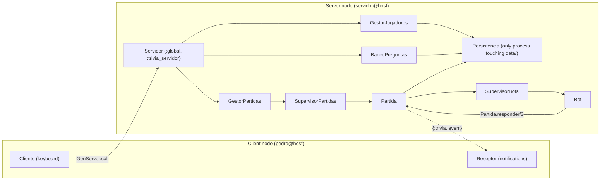

# Trivia Concurrente

Distributed console trivia game written in **Elixir/OTP**. Final project for **Programación III**, Systems Engineering, Universidad del Quindío.

> The full Spanish documentation (the primary reference for the course) is in [README.es.md](README.es.md). This file follows the same structure in English.

## 1. Description

A central **server node** holds users, the question bank and the game history, and runs every game. Each **client** runs in its own Erlang VM, connects through Erlang distribution and plays against **bots**, which are independent processes. It is a new project built on the technical base of the course's previous project (a distributed Pokémon battle platform), reusing its node-role startup, `:global` registration, one-GenServer-per-room with PID notifications, and JSON persistence. Every game is its own `GenServer` under a `DynamicSupervisor`, so games run in parallel, never block each other, and restart on their own when they crash.

## 2. Objective

Practise concurrent and distributed programming with Elixir/OTP: processes, message passing, `GenServer`, `DynamicSupervisor`, non-blocking timers, node-to-node communication, centralised persistence and automated tests.

## 3. Technologies

Elixir `~> 1.19`, Erlang/OTP 26+, Mix, ExUnit, `GenServer`, `DynamicSupervisor`, `Task.Supervisor`, `:global`, `Stream`, `:crypto`, and [Jason](https://hex.pm/packages/jason) (the only dependency). There is no database, no Phoenix and no web UI.

## 4. Architecture



Server supervision tree (`:one_for_one`): `Persistencia`, `BancoPreguntas`, `GestorJugadores`, `SupervisorBots`, `SupervisorPartidas`, `GestorPartidas`, `TareasServidor` (Task.Supervisor) and `Servidor`. A client node only starts `Trivia.SupervisorCliente`, the supervisor for its receiver process.

## 5. Directory layout

```text
config/            config.exs, dev.exs, test.exs, prod.exs
data/questions.json  question bank (versioned); users.json and results.log are created at runtime
lib/trivia/        application, servidor, comandos, errores, gestor_jugadores, gestor_partidas,
                   partida, reglas, supervisor_partidas, supervisor_bots, bot, banco_preguntas,
                   nivel, puntuacion, estadisticas, persistencia, cliente, receptor, presentacion
test/              ExUnit tests and test/support/
```

## 6. Module responsibilities

| Module | Responsibility |
|---|---|
| `Servidor` | Receives `{:comando, token, line, receiver_pid}`, handles each request in a supervised task and routes it. |
| `Comandos` | Parses the command text on the server side. |
| `Errores` | Catalogue of domain errors, with Spanish messages. |
| `GestorJugadores` | Registration, salted SHA-256 passwords, one token-based session per user, client monitoring, score and rankings. |
| `GestorPartidas` | Unique game ids, one game per player, game lookup and restart detection. |
| `Partida` | One game: bots, rounds, timers, answers, scoring, ending and history. |
| `Reglas` | Pure validation of assembly and answer rules. |
| `SupervisorPartidas` / `SupervisorBots` | `DynamicSupervisor`s for games (`:transient`) and bots (`:temporary`). |
| `Bot` | Automatic player that answers with `Process.send_after/3`. |
| `BancoPreguntas` | Loads and validates `questions.json`; random draw without repeats. |
| `Nivel`, `Puntuacion`, `Estadisticas` | Levels and question distribution, points and speed bonus, statistics from the history. |
| `Persistencia` | The only process that reads or writes files. |
| `Cliente`, `Receptor`, `Presentacion` | Keyboard loop, notification process and text formatting. |

## 7. Data model

- `questions.json`: `{"preguntas": [{id, tema, nivel (basico|intermedio|avanzado), enunciado, opciones {A,B,C,D}, respuesta}]}`. It ships 120 questions: 4 topics (`ciencia`, `historia`, `tecnologia`, `geografia`) × 10 per level.
- `users.json`: `{"usuarios": [{usuario, sal, clave_hash, registrado_en}]}`.
- `results.log`: one JSON object per finished game (`id`, `fecha`, `tema`, `creador`, `motivo` completada|abandono, `rondas_jugadas`, `jugadores` [{nombre, tipo humano|bot, puntos}], `ganadores`, `empate`). This log is the single source of truth for every statistic.

## 8–10. Installation, dependencies and configuration

```bash
git clone https://github.com/leandro-ortegon/trivia_concurrente.git
cd trivia_concurrente
mix deps.get && mix compile
```

Settings in `config/config.exs`: `:directorio_datos` (`"data"`), `:pausa_entre_rondas_ms` (`3000`) and `:nombre_servidor` (`"servidor"`). The node role comes from its name (`servidor@…` is the server); you can force it with `TRIVIA_ROL=servidor|cliente`.

## 11–13. Starting the server and the clients

```bash
iex --sname servidor --cookie trivia -S mix          # once
iex --sname pedro --cookie trivia -S mix             # each client, own terminal
iex(pedro@PC)1> Trivia.Cliente.iniciar()             # or Trivia.Cliente.iniciar(:"servidor@HOST")
```

The client runs `Node.connect/1` and `:global.sync/0`, then calls `{:global, :trivia_servidor}`. The server sends notifications to the client's receiver PID. All nodes must share the same cookie; if short names don't resolve across machines, use `--name name@IP` on every node.

## 14. Commands

`connect <user> <password>`, `disconnect`, `create_game tema=<topic> preguntas=<n> tiempo=<seconds>`, `add_bot facil|dificil`, `start_game`, `answer A|B|C|D`, `score`, `ranking`, `ranking <topic>`, `leave_game`, plus the local commands `help` and `exit`. The `bot_` prefix is reserved, and a user can have only one session at a time.

## 15–16. Games and scoring

- Each game has 1 human and 2–3 bots. The creator's level in the topic is computed from the history (below 60: basic; 60–179: intermediate; 180 or more: advanced) and stays fixed for the game. Questions are distributed 70/30/0, 20/60/20 or 0/30/70: the other levels are truncated and the remainder goes to the player's level. Questions are drawn without repeats and sorted from easiest to hardest.
- Every round goes to all players at once. A round closes when everyone has answered or when its timer fires (`Process.send_after/3`), and only each player's first valid answer counts. Then come the results and a 3-second pause with no open round.
- Points per question: basic +10/−5, intermediate +15/−8, advanced +20/−10, unanswered 0. A correct answer adds `trunc(5 * seconds_left / question_time)`.
- When a game ends the server computes the ranking and the winner or tie, saves the result and frees the player. If the human leaves or disconnects mid-game, the partial result is saved.

## 17. Bots

Easy: 40/30/20 % accuracy, answering after 40–90 % of the time. Hard: 80/70/60 %, after 10–40 %. Each bot is its own process. It gets the question (plus the correct letter, since it is an internal server process), schedules its answer with `Process.send_after/3`, and answers through `Partida.responder/3`, the same path a human uses. Bots are never stored in `users.json` and never appear in historical rankings.

## 18–20. Persistence, concurrency and restarts

- One `Persistencia` process serialises every file access. `users.json` is written atomically, and `results.log` is append-only and read with `Stream`.
- The server handles each request in its own task. Timers are messages; nothing on the server sleeps. Reading the keyboard and receiving notifications happen in separate client processes. Sessions and games monitor the client's receiver PID.
- Games use `restart: :transient`. A crashed game restarts with the same initial arguments, in `:esperando` state, without bots and with no progress. The new process casts `{:partida_iniciada, id, pid}` from `init/1`, using a cast to avoid deadlocking `GestorPartidas`, which may be waiting in `start_child`. `GestorPartidas` detects the new PID and notifies the creator. Other games are unaffected. To demo it from the server console: `Trivia.GestorPartidas.simular_fallo(id)`.

## 21. Tests

```bash
mix test                       # last run: 10 doctests, 80 tests, 0 failures
mix format --check-formatted
```

The suite covers the seven requested tests (scoring, question draw, answer validation, game assembly, statistics from history, bots, levels) plus integration tests for full games, abandonment, disconnection, restarts and sessions. The tests use isolated temporary data folders and no distributed nodes.

## 22. Troubleshooting

See the table in [README.es.md](README.es.md#22-solución-de-problemas-frecuentes). The most common causes are a different cookie, a misspelled server node name, a firewall blocking EPMD (port 4369), or a client started without `--sname`.

## Use of AI

Claude (Anthropic), working in agent mode, was used to audit the previous Pokémon project, design the OTP architecture, implement the modules, write the question bank, tests and documentation, and run the multi-node checks. All code was compiled with `--warnings-as-errors` and validated with the test suite and with real multi-node runs. The team is responsible for understanding and defending every module.
